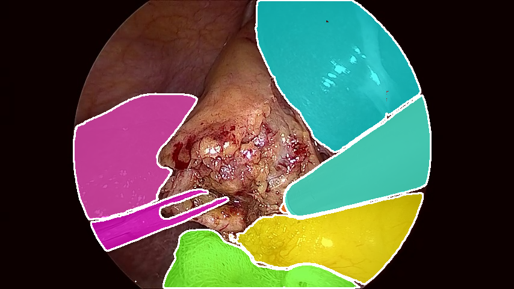
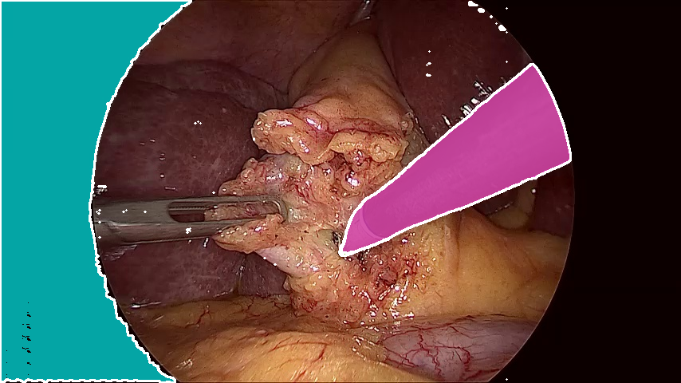
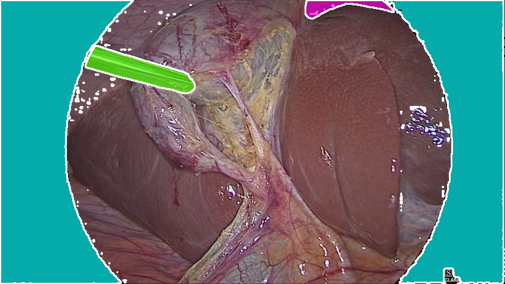
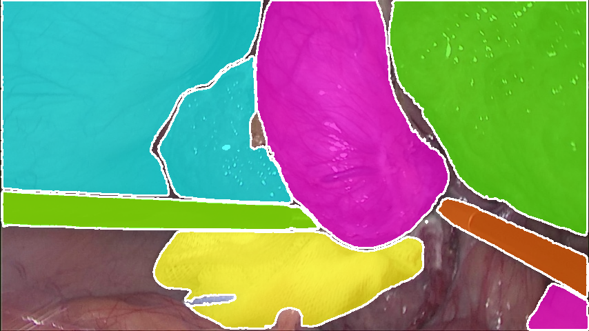

# SAM 2 for Surgical Image Segmentation

Zero-shot surgical image segmentation using **Meta's Segment Anything Model 2 (SAM 2)** on the **Endoscapes laparoscopic surgery dataset**.

The project explores the ability of SAM 2 to automatically identify and segment relevant regions in laparoscopic surgical images without task-specific training. The pipeline includes automatic mask generation, ground-truth comparison, quantitative evaluation, and GPU-accelerated inference.

##  Project Overview

Laparoscopic surgery produces complex visual scenes containing anatomical structures, surgical instruments, and surrounding tissue. Accurate segmentation of these regions can support computer-assisted surgery and downstream surgical vision tasks.

This project evaluates **SAM 2** in a zero-shot setting on the Endoscapes dataset.

### Key objectives

- Apply SAM 2 to laparoscopic surgical images without additional model training.
- Generate segmentation masks automatically using SAM 2.
- Compare predicted masks against Endoscapes ground-truth segmentation masks.
- Evaluate segmentation performance using standard metrics.
- Investigate the effect of SAM 2 automatic mask-generation parameters.
- Build a GPU-accelerated inference pipeline suitable for large-scale evaluation.

##  Model

The project uses **SAM 2.1 Hiera Large**, a high-capacity variant of Meta's Segment Anything Model 2.

**Model:**
`sam2.1_hiera_large.pt`

**Configuration:**
`sam2.1/sam2.1_hiera_l.yaml`

SAM 2 is used in an **automatic mask generation** setting, meaning the model generates candidate regions without requiring manually provided points or bounding boxes.

> **Note:** SAM 2 produces class-agnostic masks. The current evaluation therefore focuses on foreground segmentation rather than directly predicting individual semantic classes.

## 📊 Dataset

The project uses the **Endoscapes** dataset, which contains laparoscopic surgical images and corresponding segmentation annotations.
dataset available at: https://github.com/CAMMA-public/Endoscapes
Dataset structure:

```text
endoscapes/
├── train/
├── val/
├── test/
├── train_seg/
├── val_seg/
└── test_seg/
```

The segmentation label map contains the following categories:

```text
background
cystic_plate
calot_triangle
cystic_artery
cystic_duct
gallbladder
tool
```

For the current binary evaluation, the ground-truth segmentation is converted into:

```text
0 → background
1 → foreground
```

## ⚙️ Methodology

The overall pipeline is:

```text
Endoscapes Images
       │
       ▼
   Image Loading
       │
       ▼
      SAM 2
       │
       ▼
Automatic Mask Generation
       │
       ▼
Mask Filtering / Combination
       │
       ▼
Binary Prediction Mask
       │
       ▼
Comparison with Ground Truth
       │
       ▼
IoU / Dice / Precision / Recall
```

### 1. Image preprocessing

Images are loaded using OpenCV and converted from BGR to RGB before being passed to SAM 2.

### 2. Automatic mask generation

SAM 2's `SAM2AutomaticMaskGenerator` is used to generate candidate segmentation regions.

Important parameters investigated include:

- `points_per_side`
- `pred_iou_thresh`
- `stability_score_thresh`
- `min_mask_region_area`
- `crop_n_layers`

Increasing the sampling density and relaxing filtering thresholds can produce more candidate masks, but may also increase false-positive regions.

### 3. Ground-truth processing

The Endoscapes segmentation masks are converted into binary foreground masks for the current evaluation.

### 4. Evaluation

Predicted segmentation masks are compared with the corresponding ground-truth masks.

The following metrics are calculated:

**Intersection over Union (IoU)**

```text
IoU = TP / (TP + FP + FN)
```

**Dice coefficient**

```text
Dice = 2TP / (2TP + FP + FN)
```

**Precision**

```text
Precision = TP / (TP + FP)
```

**Recall**

```text
Recall = TP / (TP + FN)
```

Dice is mathematically equivalent to the F1 score for binary segmentation.

## 📈 Preliminary Results

Initial experiments using SAM 2 automatic mask generation produced the following preliminary results:

| Metric | Result |
|---|---:|
| Mean IoU | ~0.67 |
| Mean Dice | ~0.80 |
| Average masks/image | ~6.84 |

These results are from preliminary experiments and depend on the evaluated subset and mask-generation configuration.

Further experiments are planned using the latest SAM version(SAMV3.1) to establish more robust dataset-level results.

## Segmentation Results

<p align="center">
  
  
</p>

<p align="center">
  
  
</p>

## 🖥️ Hardware & Environment

Experiments were conducted on a university HPC environment using NVIDIA A100 GPUs.

### Hardware

- NVIDIA A100 80GB
- CUDA-enabled PyTorch

### Software

- Python 3.10
- PyTorch
- SAM 2
- OpenCV
- NumPy
- Pandas
- Matplotlib
- Hydra

## 🚀 Installation

Clone the repository:

```bash
git clone https://github.com/<your-username>/sam2-endoscapes-surgical-segmentation.git
cd sam2-endoscapes-surgical-segmentation
```

Create the environment:

```bash
python3.10 -m venv sam_v2_env
source sam_v2_env/bin/activate
```

Install dependencies:

```bash
pip install torch torchvision
pip install opencv-python numpy pandas matplotlib hydra-core
```

Clone/install SAM 2 according to the official repository instructions.

## 📁 Project Structure

```text
sam2-endoscapes-surgical-segmentation/
│
├── notebooks/
│   └── sam2_endoscapes_experiments.ipynb
│
├── scripts/
│   ├── inference.py
│   └── evaluation.py
│
├── results/
│   ├── metrics/
│   └── visualizations/
│
├── checkpoints/
│   └── sam2.1_hiera_large.pt
│
├── README.md
└── requirements.txt
```

> Model checkpoints and the Endoscapes dataset should generally not be committed to GitHub due to their size and licensing/distribution considerations.

## 🔬 Example SAM 2 Configuration

```python
mask_generator = SAM2AutomaticMaskGenerator(
    sam,
    points_per_side=64,
    pred_iou_thresh=0.78,
    stability_score_thresh=0.82,
    min_mask_region_area=100,
    crop_n_layers=1
)
```

These parameters are experimental and are not intended to represent universally optimal settings.

## 📌 Important Limitation

SAM 2's automatic mask generator produces **class-agnostic region proposals** rather than semantic class labels.

Therefore, directly combining all generated masks into a single foreground prediction is a relatively coarse evaluation strategy.

Future evaluation can improve this by:

- Matching predicted masks to individual ground-truth regions.
- Evaluating each anatomical class separately.
- Using point or box prompts for controlled segmentation.
- Computing per-class IoU and Dice.
- Performing object-level mask matching.
- Comparing automatic mask generation against prompt-based SAM 2 segmentation.

## 🔮 Future Work

- [ ] Evaluate the complete Endoscapes test set.
- [ ] Implement class-wise segmentation evaluation.
- [ ] Develop principled predicted-mask to ground-truth matching.
- [ ] Compare automatic and prompt-based SAM 2 segmentation.
- [ ] Experiment with different SAM 2 model sizes.
- [ ] Investigate fine-tuning SAM 2 for surgical imagery.
- [ ] Build an interactive Streamlit visualization interface.
- [ ] Analyze performance across different surgical scenes and anatomical structures.

## 👨‍💻 Project

**Zero-Shot Surgical Image Segmentation using SAM 2**

Technologies:

`Python` · `PyTorch` · `SAM 2` · `OpenCV` · `NumPy` · `Pandas` · `CUDA` · `NVIDIA A100` · `Endoscapes`

---

### Acknowledgements

This project uses:

- **Meta Segment Anything Model 2 (SAM 2)**
- **Endoscapes dataset**
- PyTorch and the broader open-source computer vision ecosystem

Please refer to the original projects for their respective licenses, datasets, and citation requirements.
